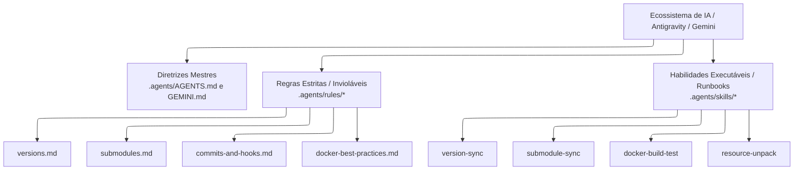

# Arquitetura: Governança e Automação com Agentes de IA

A partir da versão 3.0, o repositório **TOTVS-Protheus-in-Docker** adota uma arquitetura formal de **Engenharia de Software Assistida por Inteligência Artificial (Agentic AI Coding)**.

O objetivo é permitir que assistentes inteligentes (como o **Google Antigravity**, **Gemini** e **Claude Code**) atuem como desenvolvedores pares (Pair Programmers), executando rotinas complexas de DevOps sem quebrar convenções nem introduzir desvios na infraestrutura.

---

## 🏛️ 1. O Diretório `.agents/` e a Infraestrutura de Contexto

Toda a governança de IA do projeto reside no diretório padronizado **`.agents/`**, composto por quatro pilares:

---

## 📜 2. Regras Estritas de Comportamento (`.agents/rules/`)

As regras são restrições rígidas que os agentes de IA devem obedecer compulsoriamente:

1. **`versions.md`:**  
   Impede que o agente altere qualquer versão diretamente em um Dockerfile. Ele é obrigado a editar o `versions.env` e disparar `./scripts/validation/versions.sh --fix`.
2. **`submodules.md`:**  
   Proíbe que o agente tente commitar mudanças de um serviço diretamente na raiz do repositório antes de realizar o commit e push no submódulo correspondente.
3. **`commits-and-hooks.md`:**  
   Obriga o uso de Conventional Commits e veta estritamente o uso da flag `--no-verify`.
4. **`docker-best-practices.md`:**  
   Garante padrões consistentes de healthchecks, imagens Enterprise Linux e mitigação do erro de `ulimit`.

---

## 🛠️ 3. Skills Executáveis (`.agents/skills/`)

Skills são guias operacionais determinísticos (*runbooks*) invocados sob demanda pelo agente para executar procedimentos técnicos complexos:

| Skill | Localização | Quando o Agente Executa |
|---|---|---|
| **`version-sync`** | `.agents/skills/version-sync/` | Durante bumps de versão, atualizações de release do Protheus ou correção de descompasso de tags. |
| **`submodule-sync`** | `.agents/skills/submodule-sync/` | Ao alternar entre branches de release (`12.1.2510` vs `12.1.2610`) ou sincronizar ponteiros Git. |
| **`docker-build-test`** | `.agents/skills/docker-build-test/` | Para orquestrar compilações locais seguras e executar smoke tests via `test-compose.sh`. |
| **`resource-unpack`** | `.agents/skills/resource-unpack/` | Na preparação e descompactação de binários brutos da TOTVS dentro de `services/*/packages/`. |

---

## 🎯 4. Benefícios Práticos para a Equipe

* **Zero Alucinação de Infraestrutura:** O agente nunca tenta inventar caminhos de diretórios ou comandos que não existam na arquitetura.
* **Consistência em Releases:** Atualizar a release da stack de 12.1.2510 para 12.1.2610 pode ser realizado com um comando ao agente ("execute a skill version-sync para a release 12.1.2610").
* **Documentação Viva:** A documentação técnica e os arquivos de contexto de IA evoluem no mesmo commit que o código e a infraestrutura.
