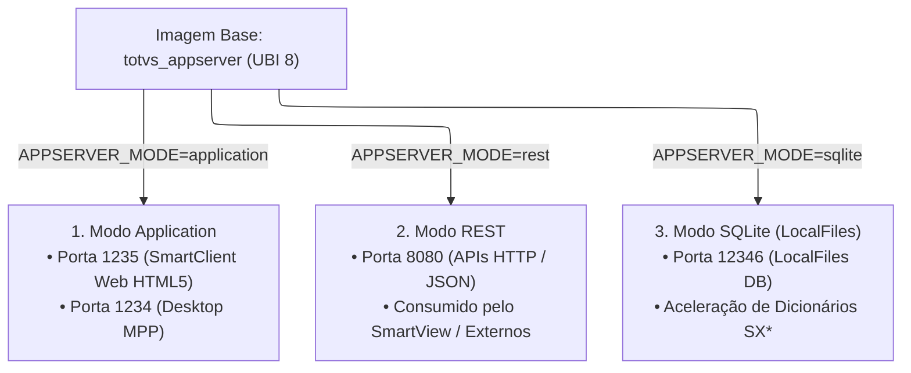

# Arquitetura: Modos de Operação do AppServer

Em vez de criar imagens Docker diferentes para cada função que o servidor Protheus desempenha, a arquitetura utiliza **uma única imagem unificada (`totvs_appserver`)** cujo comportamento técnico é modelado dinamicamente no boot através da variável **`APPSERVER_MODE`**.

---

## 🎭 1. Os Três Modos de Operação

---

## 🖥️ 2. Detalhamento dos Modos

### 2.1. Modo `application` (Padrão)
* **Objetivo:** Servir sessões interativas para usuários finais do ERP.
* **Componentes Ativos:**
  * **SmartClient Web (Porta 1235):** Embutido nativamente no binário, permitindo que qualquer usuário acesse a interface Protheus diretamente pelo navegador sem instalar nada no computador local.
  * **Conexão Desktop / IDE (Porta 1234):** Suporta conexões do executável clássico `smartclient.exe` e atua como servidor de compilação para o **TOTVS Developer Studio (TDS / VS Code)**.
* **Otimização:** Alocação de memória balanceada por thread de usuário (`MaxStringSize`, `ThreadStackSize`).

---

### 2.2. Modo `rest` (APIs e Integrações)
* **Objetivo:** Microserviço dedicado exclusivamente para atender requisições HTTP RESTful, WebServices SOAP e integrações externas.
* **Porta Padrão:** `8080`.
* **Vantagens de Isolar em Container Próprio:**
  1. **Proteção contra Gargalos:** Uma rotina de integração em massa (ex.: emissão de milhares de pedidos via API externa) não consome os recursos nem congela a interface dos usuários no modo `application`.
  2. **Consumo pelo SmartView:** O motor de relatórios SmartView faz requisições pesadas de metadados diretamente para o serviço REST.
  3. **Escalabilidade:** Em ambientes maiores, o container `totvs_apprest` pode ser escalado horizontalmente com um load balancer (Nginx/Traefik).

---

### 2.3. Modo `sqlite` (LocalFiles de Alta Performance)
* **Objetivo:** Otimizar e acelerar operações que historicamente dependiam de arquivos temporários e tabelas c-tree locais.
* **Porta Interna:** `12346`.
* **Como Funciona:**
  * O Protheus utiliza um banco local rápido para controlar dicionários em memória, schemas e tabelas de trabalho (`SX2`, `SX3`, `SIX`).
  * Ao configurar `APPSERVER_ENVIRONMENT_LOCALFILES=SQLITE`, o AppServer desvia essas consultas I/O intensivas para instâncias SQLite otimizadas (`APPSERVER_SQLITE_INSTANCES="1,10,1,1"`).
  * O tempo de abertura de telas complexas do ERP é reduzido drasticamente.

---

## ⚙️ 3. Renderização Dinâmica do `appserver.ini`

O entrypoint do AppServer não utiliza arquivos `.ini` estáticos com caminhos fixos. Durante o início do container, o script shell lê todas as variáveis do ambiente (`APPSERVER_*`, `DATABASE_*`, `LICENSE_*`) e renderiza um novo `appserver.ini` sob medida.

Isso garante que alterações de senha, hosts de banco ou portas no arquivo `.env` entrem em vigor imediatamente com um simples `docker compose restart appserver`.
