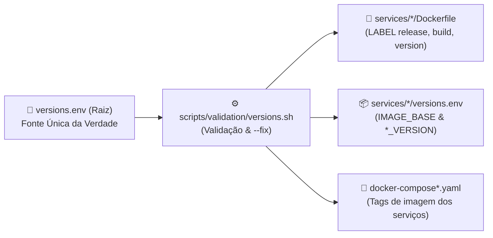

# Arquitetura: A Fonte Única de Verdade (`versions.env`)

Um dos maiores desafios em arquiteturas multi-repositórios é o **desvio de versão (version drift)**: situações em que um Dockerfile aponta para uma versão, o Docker Compose solicita outra tag e a esteira de CI/CD compila com parâmetros divergentes.

No **TOTVS Protheus in Docker**, este problema é erradicado através do arquivo **`versions.env`** na raiz do projeto.

---

## 🎯 1. Princípio da Fonte Única da Verdade (SSOT)

Nenhum `Dockerfile`, script orquestrador ou workflow de CI possui versões de componentes codificadas de forma fixa (*hardcoded*).

O arquivo `versions.env` dita com precisão:
1. **Identidade no Registry:** Usuário e organização no Docker Hub (`DOCKER_USER=juliansantosinfo`).
2. **Identificador da Release de Recursos:** Metadado mestre da release de pacotes (`RESOURCE_RELEASE=release2610`).
3. **Versão Oficial da Release do ERP:** `APPSERVER_RELEASE=12.1.2610`.
4. **Builds Granulares dos Binários TOTVS:**
   * Build do AppServer (`26.3.0.0`)
   * Versão do WebApp HTML (`26.0.0`)
   * Biblioteca DBAPI (`26.1.0.0`)
   * DBAccess (`26.1.0.0`)
   * License Server (`3.7.2`)
   * SmartView (`3.9.0.4558336`)
5. **Versões de Imagens de Banco de Dados:** PostgreSQL 15, SQL Server 2019, Oracle 21.3.0.

---

## 🛡️ 2. O Validador Mestre (`versions.sh`)

Para que a SSOT funcione de maneira infalível, existe o script **`scripts/validation/versions.sh`**, que valida e propaga o `versions.env` para três camadas simultaneamente:



### Como funciona a validação em 3 camadas:
1. **Camada 1 — `services/*/Dockerfile`:** Inspeciona os metadados declarados em diretivas `LABEL` (`release`, `build`, `dbapi`, `webapp` e `version`):
   ```dockerfile
   LABEL release="12.1.2610"
   LABEL build="26.3.0.0"
   ```
2. **Camada 2 — `services/*/versions.env`:** Verifica se os arquivos `versions.env` internos de cada submódulo (incluindo a tag composta de `IMAGE_BASE`) estão alinhados com a raiz.
3. **Camada 3 — `docker-compose*.yaml`:** Confere se as tags `image: <user>/<app>:<tag>` nos 4 arquivos Compose (`docker-compose.yaml`, `mssql`, `postgresql`, `oracle`) correspondem exatamente às versões ativas.

Se houver qualquer divergência em qualquer uma das três camadas, o script reporta a inconsistência e falha com código `1`.

### Correção Idempotente Automática (`--fix`)
Ao invés de editar manualmente múltiplos Dockerfiles, arquivos Compose e `versions.env` internos em pastas diferentes, o desenvolvedor executa:
```bash
./scripts/validation/versions.sh --fix
# Ou pelo atalho do Makefile:
make fix
```
O script reescreve automaticamente os `LABEL`s nos Dockerfiles, os `services/*/versions.env` e as tags nos 4 arquivos `docker-compose*.yaml`, garantindo paridade instantânea em todos os 7 submódulos.

---

## 🔗 3. Integração com a Esteira de Governança e Diagnóstico

A consistência de versões não depende da lembrança humana. Ela é imposta em três pontos:
1. **Diagnóstico Inteligente (`make status` / `./scripts/validation/status.sh`):** Exibe em tempo real na matriz de serviços se algum componente está com versão divergente.
2. **No Host Local (Git Hook `pre-commit`):** O commit é abortado localmente se as versões estiverem desalinhadas.
3. **Na Nuvem (GitHub Actions Job `lint-and-validation`):** A esteira rejeita o Pull Request se alguém tentar forçar o commit com versões inconsistentes.
