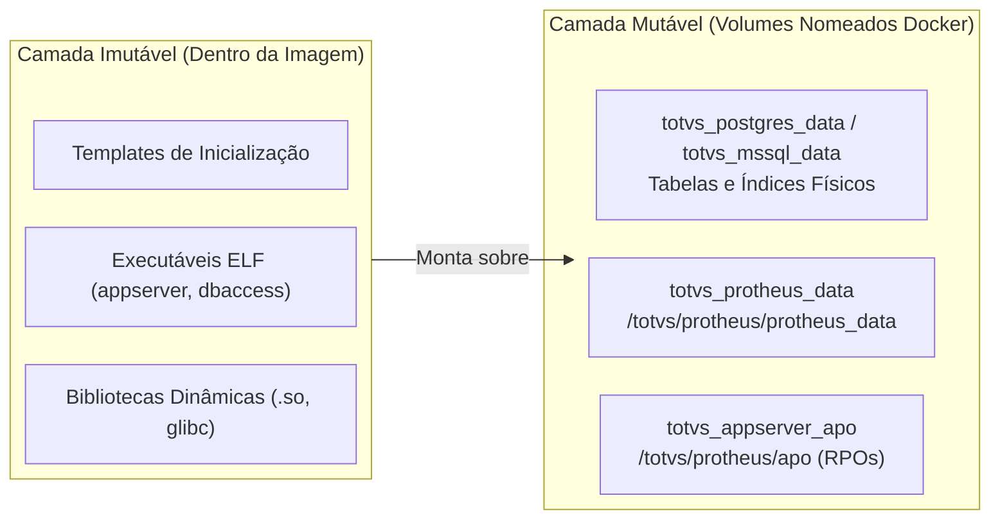

# Arquitetura: Persistência de Dados e Volumes

No contexto de contêineres para sistemas de gestão empresarial (ERP), a integridade e persistência de dados é o pilar mais crítico da arquitetura. O ecossistema TOTVS Protheus in Docker adota uma separação estrita entre **estado imutável** e **estado mutável**.

---

## 🧱 1. A Dicotomia de Estado: Imutável vs Mutável



1. **Camada Imutável:**  
   Armazenada dentro das camadas de leitura da imagem Docker. Quando uma nova versão do AppServer é lançada, a imagem é atualizada sem qualquer risco de sobrescrever os dados cadastrais do cliente.
2. **Camada Mutável:**  
   Armazenada exclusivamente em **Volumes Nomeados gerenciados pelo Docker** ou **Bind Mounts** explícitos no host. Sobrevive a comandos `docker compose down`, reinicializações de máquina e atualizações de containers.

---

## 📦 2. Mapeamento de Volumes Nomeados

| Volume Docker | Ponto de Montagem no Container | Conteúdo Armazenado | Criticidade |
|---|---|---|---|
| `totvs_protheus_data` | `/totvs/protheus/protheus_data` | Dicionários de dados (`SX*`), arquivos temporários, logs e perfis de usuários. | **Vital:** Não deve ser excluído em manutenções rotineiras. |
| `totvs_appserver_apo` | `/totvs/protheus/apo` | Repositórios de objetos compilados (`tttp120.rpo` e `custom.rpo`). | **Alta:** Onde vivem os fontes compilados do cliente. |
| `totvs_postgres_data` | `/var/lib/postgresql/data` | Arquivos brutos do banco de dados PostgreSQL. | **Vital:** Contém todos os registros e tabelas Protheus. |
| `totvs_mssql_data` | `/var/opt/mssql/data` | Arquivos `.mdf` e `.ldf` do Microsoft SQL Server. | **Vital:** Banco de dados SQL Server. |

---

## 🔄 3. Ciclo de Vida: Flag `EXTRACT_RESOURCES`

Para que o desenvolvedor não precise rodar instaladores manuais demorados (wizards) que levariam horas criando estruturas de dicionário do zero, o projeto adota a estratégia de **Snapshots Pré-carregados**:

1. Na primeira partida do container, o entrypoint verifica se o volume `totvs_protheus_data` está vazio.
2. Se estiver vazio e a variável `EXTRACT_RESOURCES=true` estiver ativa, o script descompacta o arquivo `protheus.tar.gz` (fornecido no build) diretamente no volume.
3. Nas inicializações subsequentes, mesmo com `EXTRACT_RESOURCES=true`, o entrypoint detecta a presença de arquivos existentes e **não sobrescreve** suas alterações.

---

## 💾 4. Estratégia de Backup de Volumes

Para fazer backup dos dados mutáveis da stack sem parar o ambiente:
```bash
# Exportar o volume protheus_data para um arquivo tar no host
docker run --rm -v totvs_protheus_data:/data -v $(pwd):/backup ubuntu tar czf /backup/protheus_data_backup.tar.gz -C /data .
```
