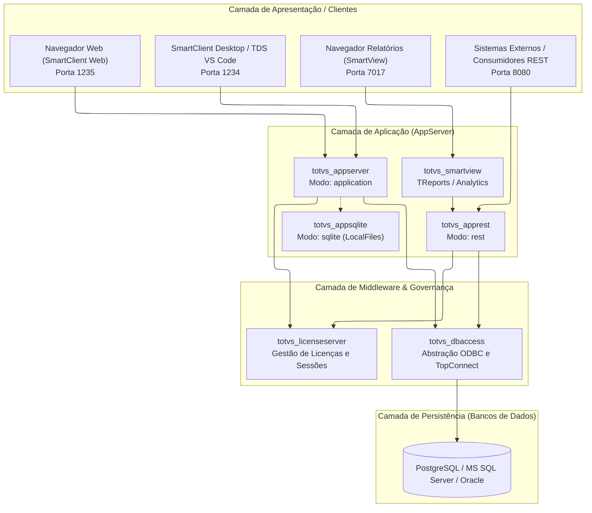

# Arquitetura: Visão Geral do Ecossistema

O projeto **TOTVS Protheus in Docker** decompõe o ERP tradicional e monolítico em uma **arquitetura moderna de microserviços em contêineres**, desacoplando cada subsistema técnico em contêineres de responsabilidade única.

---

## 🏛️ 1. Princípios de Design Arquitetural

1. **Princípio da Responsabilidade Única (SRP):** Cada contêiner executa estritamente um papel (ex.: o AppServer de SmartClient não divide recursos com a API REST).
2. **Imutabilidade de Binários:** O produto oficial TOTVS é pré-empacotado nas imagens de forma imutável, enquanto configurações e dados residem em volumes e variáveis de ambiente.
3. **Resiliência de Inicialização (Fail Fast & Wait):** Middleware e servidores aguardam assincronamente a disponibilidade de suas dependências via verificações de rede no entrypoint, eliminando condições de corrida na largada da stack.
4. **Base Enterprise Linux:** Todos os microserviços são construídos sobre **Red Hat Universal Base Image (UBI 8)** ou **Oracle Linux 8**, garantindo segurança corporativa, suporte a bibliotecas C++ nativas e compatibilidade estrita com os binários ELF da TOTVS.

---

## 🧩 2. Camadas do Ecossistema

---

## 🛡️ 3. Por que Enterprise Linux (UBI / Oracle Linux)?

Historicamente, muitos projetos comunitários tentaram rodar o Protheus sobre Alpine Linux ou Ubuntu, enfrentando frequentes *segmentation faults* devido à incompatibilidade com a biblioteca `glibc` ou ausência de bibliotecas gráficas legadas (`libnsl`, `libgdiplus`).

Nossa arquitetura padronizou:
* **Red Hat UBI 8:** Para o AppServer, REST e DBAccess. Fornece conformidade de segurança e estabilidade corporativa.
* **Oracle Linux 8:** Para o Oracle Database e SmartView, viabilizando o uso de repositórios EPEL para fontes Microsoft e suporte gráfico de renderização de PDF.
* **Eliminação de Camadas Obsoletas:** Servidores web legados em Python/Flask que existiam nas primeiras versões do projeto foram totalmente extirpados em prol de máxima leveza e segurança.
