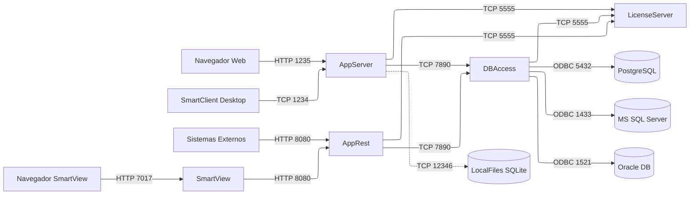

# Referência: Matriz de Portas e Redes TCP/IP

Este documento detalha o mapa completo de conectividade, exposição de portas e topologia de rede do ecossistema TOTVS Protheus in Docker.

---

## 🌐 1. Topologia da Rede Docker

Por padrão, todos os serviços operam conectados à rede bridge dedicada nomeada **`totvs`**.

* **Isolamento de Comunicação:** Os contêineres comunicam-se entre si através do DNS interno do Docker, utilizando os nomes dos serviços (ex: `totvs_dbaccess`, `totvs_licenseserver`, `totvs_postgres`).
* **Resolução de Nomes:** Nenhuma configuração de IP fixo é necessária; os hostnames são resolvidos dinamicamente pela engine do Docker.

---

## 📊 2. Matriz Consolidada de Portas

| Serviço | Container | Porta Interna | Porta no Host | Protocolo | Finalidade | Público-Alvo |
|---|---|---|---|---|---|---|
| **AppServer** | `totvs_appserver` | `1235` | `1235` | HTTP / WebSocket | SmartClient Web (Interface no navegador) | Usuários / Desenvolvedores |
| **AppServer** | `totvs_appserver` | `1234` | `1234` | TCP (MPP) | SmartClient Desktop convencional | Analistas / Devs (TDS / VS Code) |
| **AppRest** | `totvs_apprest` | `8080` | `8080` | HTTP | APIs REST do Protheus / WebServices | Integrações externas / SmartView |
| **AppSQLite** | `totvs_appsqlite` | `12346` | *(Interna)* | TCP | LocalFiles Dicionário em SQLite | Apenas comunicação inter-container |
| **DBAccess** | `totvs_dbaccess` | `7890` | `7890` | TCP / HTTP | Monitor DBAccess (Console) e comunicação ODBC | Administradores de Banco / AppServer |
| **License Server** | `totvs_licenseserver` | `5555` | `5555` | TCP | Validação e concessão de licenças TOTVS | AppServer / DBAccess |
| **License Server** | `totvs_licenseserver` | `2234` | `2234` | TCP | Porta de comunicação interna de licença | Ferramental de licença |
| **License Server** | `totvs_licenseserver` | `8020` | `8020` | HTTP | Monitor Web do License Server | Administrador do License |
| **SmartView** | `totvs_smartview` | `7017` | `7017` | HTTP | Interface Web do SmartView (Relatórios) | Usuários / Analistas de BI |
| **SmartView** | `totvs_smartview` | `7019` | `7019` | HTTP | API Interna de Processamento SmartView | AppRest / Comunicação interna |
| **PostgreSQL** | `totvs_postgres` | `5432` | `5432` | TCP | Banco de Dados PostgreSQL | DBAccess / DBeaver / pgAdmin |
| **MS SQL Server** | `totvs_mssql` | `1433` | `1433` | TCP | Banco de Dados SQL Server | DBAccess / SSMS / Azure Data Studio |
| **Oracle Database** | `totvs_oracle` | `1521` | `1521` | TCP | Banco de Dados Oracle (Listener TNS) | DBAccess / PL/SQL Developer / SQLcl |

---

## 🔄 3. Fluxo de Comunicação Inter-Container (Interno)

O diagrama a seguir sintetiza as rotas obrigatórias de tráfego de dados dentro da rede Docker `totvs`:



---

## 🔒 4. Recomendações de Segurança

1. **Exposição em Ambientes Compartilhados:**  
   Em servidores compartilhados na rede corporativa, evite mapear diretamente as portas de banco de dados (`1433`, `5432`, `1521`) e de licença (`5555`) para `0.0.0.0`. Se precisar de acesso administrativo remoto, utilize túneis SSH ou amarre ao IP de localhost (`127.0.0.1:5432:5432`).
2. **Conflito de Portas no Host:**  
   Se sua máquina já tiver uma instância local do SQL Server (1433) ou PostgreSQL (5432) rodando nativamente no Windows/Linux, altere o mapeamento da porta à esquerda no `docker-compose-*.yaml`:
   ```yaml
   ports:
     - "15432:5432" # Expõe no Host como 15432 sem alterar a porta interna do container
   ```
