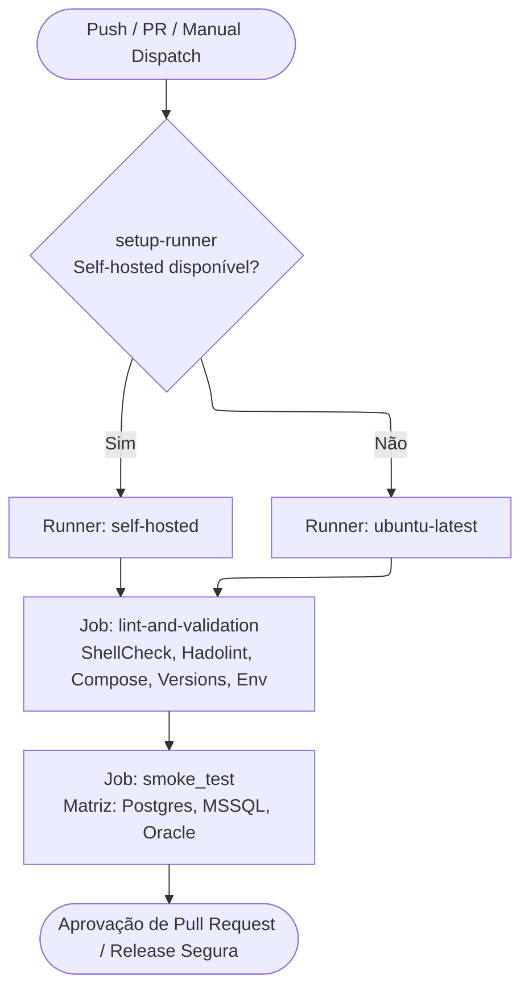

# Referência: Especificação das Pipelines de CI/CD

Este documento descreve detalhadamente a arquitetura de Integração Contínua (CI) e Entrega Contínua (CD) do repositório, implementada através do **GitHub Actions** em `.github/workflows/deploy.yml` e `.github/workflows/test.yml`.

---

## 🚀 1. Visão Geral da Pipeline (`deploy.yml`)

A pipeline principal é responsável por garantir a sanidade de código, qualidade de linters, conformidade de versões e execução de **smoke tests** em containers reais antes de qualquer merge.



---

## ⚡ 2. Gatilhos de Execução (Triggers)

### 2.1. Eventos Automáticos
* **Push** nas branches: `master`, `main` e `12.1.*` (ex.: `12.1.2610`).
* **Pull Request** direcionados para as branches: `master`, `main` e `12.1.*`.

### 2.2. Filtro de Otimização (`paths-ignore`)
Para economizar minutos de execução e evitar builds desnecessários, alterações exclusivas nos seguintes arquivos não acionam a esteira:
* Documentação (`docs/**`, `README.md`, `GEMINI.md`, `CHANGELOG`, `LICENSE*`).
* Configurações de editor (`.vscode/**`).
* Scripts de hooks locais (`scripts/hooks/**`, `.gitignore`, `.antigravityignore`).
* Scripts interativos de máquina cliente (`run.sh`, `clean.sh`).

### 2.3. Gatilho Manual (`workflow_dispatch`)
Permite executar a esteira manualmente pelo portal do GitHub Actions com seleção de alvo:
* `service = all`: Executa os testes para todas as três stacks (`postgresql`, `mssql`, `oracle`).
* `service = docker-compose-postgresql.yaml`: Testa exclusivamente a stack PostgreSQL.
* `service = docker-compose-mssql.yaml`: Testa exclusivamente a stack Microsoft SQL Server.
* `service = docker-compose-oracle.yaml`: Testa exclusivamente a stack Oracle Database.

---

## 🏗️ 3. Detalhamento dos Jobs

### Job 1: `setup-runner` (Seleção Dinâmica de Runner)
* **Objetivo:** Otimizar custos e performance verificando se há runners corporativos locais ativos.
* **Mecanismo:** Consulta a API do GitHub (`gh api /repos/.../actions/runners`) procurando por instâncias online com a label `self-hosted`.
* **Saída:**
  * Se houver runner online: `runner=self-hosted` (maior poder de processamento e cache local de camadas Docker).
  * Se não houver: Fallback automático e transparente para `runner=ubuntu-latest`.

---

### Job 2: `lint-and-validation` (Gate de Qualidade Estática)
Executado com clone recursivo de submódulos (`submodules: recursive`). Realiza 5 checagens obrigatórias:
1. **Validação do `.env` (`./scripts/validation/env.sh`):** Garante compatibilidade estrutural de chaves entre `.env` e `.env.example`.
2. **Sintaxe Compose (`./scripts/validation/lint-compose.sh`):** Valida a compilação YAML e interpolação de variáveis via `docker compose config`.
3. **Análise de Dockerfiles (`./scripts/validation/lint-dockerfile.sh`):** Executa o `Hadolint` em todos os Dockerfiles de submódulos para barrar más práticas de segurança.
4. **Análise de Shell Scripts (`./scripts/validation/lint-shell.sh`):** Executa `ShellCheck` em todos os utilitários `.sh`.
5. **Consistência de Versões (`./scripts/validation/versions.sh`):** Garante que os labels dos Dockerfiles estejam perfeitamente alinhados com o `versions.env`.

---

### Job 3: `smoke_test` (Testes de Inicialização e Sanidade)
* **Dependência:** Aguarda a aprovação estrita do job `lint-and-validation`.
* **Estratégia de Matriz:** Executa em paralelo (`fail-fast: false`) para cada arquivo compose selecionado:
  * `docker-compose-postgresql.yaml`
  * `docker-compose-mssql.yaml`
  * `docker-compose-oracle.yaml`
* **Passos Executados:**
  1. Autenticação no Docker Hub (`docker/login-action@v3`).
  2. Execução do script mestre de teste:
     ```bash
     ./scripts/test/test-compose.sh -f <arquivo_da_matriz>
     ```
  3. O script sobe a stack com `--profile full`, aguarda até 480 segundos para que todos os serviços declarem status `healthy`, coleta eventuais falhas e desfaz os containers de forma limpa.

---

## 🩺 4. Workflow Auxiliar: `test.yml` (Diagnóstico de Docker)

O arquivo `.github/workflows/test.yml` é um gatilho de diagnóstico rápido (`workflow_dispatch`) executado em `self-hosted`:
* Valida as permissões do usuário do runner sobre o socket `/var/run/docker.sock`.
* Imprime a versão da Docker Engine ativa na máquina hospedeira.
* Usado para investigar falhas de permissão de daemon antes de subir esteiras pesadas.

---

## 🔐 5. Segredos de Repositório Necessários (GitHub Secrets)

Para a execução completa da pipeline, os seguintes segredos devem estar cadastrados no repositório:
* `DOCKER_USERNAME`: Usuário com permissão de leitura/escrita no Docker Hub.
* `DOCKER_PASSWORD`: Personal Access Token (PAT) do Docker Hub.
* `GITHUB_TOKEN`: Fornecido nativamente pelo GitHub Actions para checagem da API de runners.
