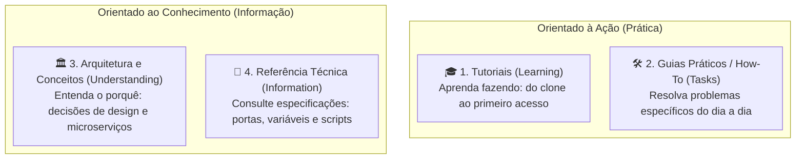

# Manual e Documentação Técnica - TOTVS Protheus in Docker (v3.0)

Bem-vindo à documentação oficial da versão **3.0** do projeto **TOTVS Protheus in Docker**.

Esta versão consolida o estágio corporativo maduro da arquitetura: **Ecossistema Modular Multi-banco, Automação de Ciclo de Vida e Ferramental de Desenvolvimento Integrado (Release 12.1.2610)**.

---

## 🧭 Navegação pelo Framework Diátaxis

A documentação da v3.0 é estruturada no padrão [Diátaxis](https://diataxis.fr/), dividida em 4 quadrantes para atender objetivamente a cada momento do seu trabalho:

---

## 📚 Índice Geral da Documentação v3.0

### 🎓 1. Tutoriais (Primeiros Passos)
Aprenda os fluxos essenciais com passos estruturados para quem está começando:
* [**01. Início Rápido (Zero ao Protheus)**](./1-tutoriais/01-inicio-rapido.md): Clone o repositório, configure variáveis e suba a stack completa em minutos.
* [**02. Primeiro Build Local de Imagens**](./1-tutoriais/02-primeiro-build-local.md): Obtenção de pacotes TOTVS, preparação com `setup.sh` e compilação de imagens personalizadas.
* [**03. Usando os Assistentes Visuais e CLI**](./1-tutoriais/03-usando-assistentes.md): Operando o assistente interativo `./run.sh` e os geradores web (Compose & Dockerfile).

### 🛠️ 2. Guias Práticos (How-To)
Receitas diretas para tarefas e operações comuns:
* [**Deploy com Perfis do Compose**](./2-guias-praticos/deploy-perfis-compose.md): Uso de perfis (`default`, `full`, `with-rest`, `with-smartview`) nos 3 bancos.
* [**Gerenciamento de Bancos de Dados**](./2-guias-praticos/gerenciando-bancos.md): Configurações específicas, backups, locales (Latin1) e restore em PostgreSQL, MSSQL e Oracle.
* [**Atualização de RPO e Fontes AdvPL/TLPP**](./2-guias-praticos/atualizando-rpo-fontes.md): Atualização a frio, bind mount de repositório de objetos e reinicialização ágil.
* [**Sincronização de Branches e Releases**](./2-guias-praticos/sincronizando-branches.md): Como migrar ou alternar releases (12.1.2310 a 12.1.2610) entre submódulos com `branch-checkout.sh`.
* [**Desenvolvimento e Manutenção em Submódulos**](./2-guias-praticos/desenvolvimento-submodulos.md): Como editar, commitar e sincronizar os serviços em `services/`.
* [**Contribuindo, Linters e Git Hooks**](./2-guias-praticos/contribuindo-e-hooks.md): Instalação de hooks locais, Hadolint, ShellCheck, detecção de segredos e Conventional Commits.
* [**Guia de Solução de Problemas (Troubleshooting)**](./2-guias-praticos/troubleshooting.md): Diagnóstico de `ulimit`, `Connection Refused` no DBAccess, portas ocupadas e análise de logs.

### 🏛️ 3. Arquitetura e Conceitos
Compreenda o design, padrões e funcionamento interno da solução:
* [**Visão Geral do Ecossistema**](./3-arquitetura/visao-geral-ecossistema.md): Microserviços, isolamento de responsabilidades, rede interna e Enterprise Linux (UBI8/Oracle Linux).
* [**A Fonte Única de Verdade (`versions.env`)**](./3-arquitetura/fonte-unica-verdade.md): Governança de versões, tags em labels Docker e sincronização com `versions.sh --fix`.
* [**Persistência de Dados e Volumes**](./3-arquitetura/persistencia-e-volumes.md): Dados imutáveis (binários do produto) vs mutáveis (`protheus_data`, APO, database data).
* [**Modos de Operação do AppServer**](./3-arquitetura/appserver-modos.md): Papéis do `application`, `rest` e `sqlite` (LocalFiles para alta performance).
* [**Automação e Agentes de IA (`.agents/`)**](./3-arquitetura/agentes-e-automacao-ia.md): Padrões de engenharia assistida por IA, regras de submodulos e skills executáveis.

### 📖 4. Referência Técnica
Tabelas completas para consulta rápida durante o desenvolvimento e sustentação:
* [**Dicionário de Variáveis de Ambiente**](./4-referencia/variaveis-ambiente.md): Todas as variáveis dos serviços, tipos, padrões e descrições.
* [**Matriz de Portas e Redes TCP/IP**](./4-referencia/matriz-portas-e-redes.md): Mapeamento de portas internas, portas expostas no Host e protocolos.
* [**Catálogo de Scripts e Utilitários CLI**](./4-referencia/catalogo-scripts-cli.md): Sintaxe, opções e flags de todos os scripts da pasta `scripts/`.
* [**Especificação das Pipelines CI/CD**](./4-referencia/pipeline-ci-cd.md): Detalhamento dos jobs no GitHub Actions (`deploy.yml` e `test.yml`).

---

## ⚡ Tabela Rápida de Referência (Cheat Sheet)

| Ação Desejada | Comando / Instrução |
|---|---|
| **Subir Stack Básica (PostgreSQL)** | `docker compose -f docker-compose-postgresql.yaml up -d` |
| **Subir Stack Completa (REST + SmartView)** | `docker compose -f docker-compose-postgresql.yaml --profile full up -d` |
| **Acessar SmartClient Web** | `http://localhost:1235` (Usuário: `admin` / Senha: ` ` - 1 espaço) |
| **Acessar Monitor DBAccess** | `http://localhost:7890` (ou via TCP via SmartClient) |
| **Assistente Interativo de Inicialização** | `./run.sh` |
| **Descompactar e Preparar Pacotes Locais** | `./scripts/build/setup.sh` |
| **Build de Todas as Imagens** | `./scripts/build/build.sh` |
| **Build de Serviço Específico** | `./scripts/build/build.sh appserver dbaccess` |
| **Sincronizar Versões dos Dockerfiles** | `./scripts/validation/versions.sh --fix` |
| **Instalar Git Hooks de Qualidade** | `./scripts/hooks/install.sh` |
| **Alternar Versão de Release** | `./scripts/validation/branch-checkout.sh 12.1.2610` |

---
*Documentação Versão 3.0 alinhada à Release 12.1.2610 - Outubro/2026.*
